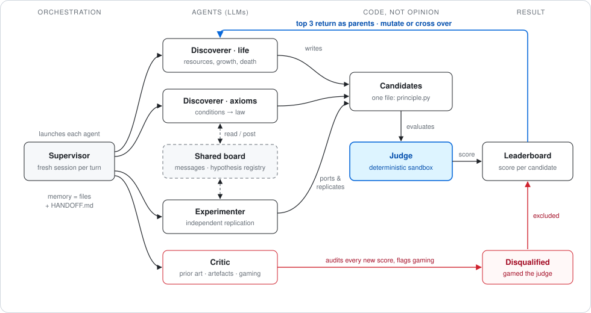
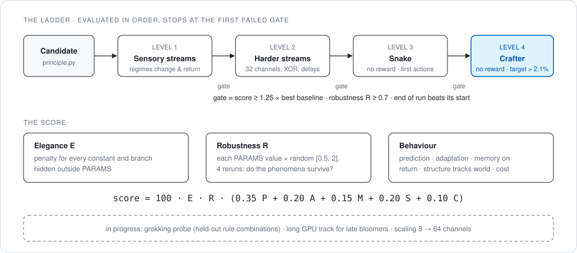
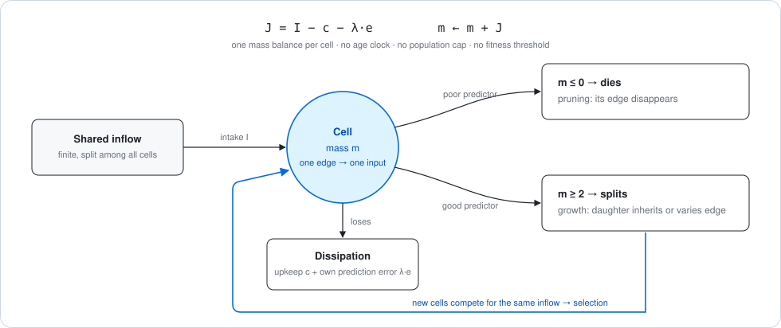

# Genesis

**A small society of AI agents searching for a single principle from which a living, learning system can grow.**

Most learning systems are assembled: a fixed architecture, a loss, a gradient, and a module bolted on for every missing
ability (memory here, exploration there). Genesis asks the opposite question. Is there one law, in the way one physical
law accounts for many phenomena, from which growth, pruning, learning, memory and exploration all *follow*? The system
must work **without external reward** and **without backpropagation**, and its structure must build itself. Biology is
the main source of inspiration.

The long-term yardstick is [Crafter](https://arxiv.org/abs/2109.06780) without reward. The first honest milestone is
modest: beat the best reward-free result from the Crafter paper, Plan2Explore at 2.1%, without reward and without
backprop. Humans score about 50%.

---

## How it works

Language-model agents (Codex CLI) propose principles and write them down as code. **Opinion never decides:** a
deterministic sandbox scores every candidate, and the critic exists to assume that each "new" idea already exists and
that each good result is an artefact until shown otherwise.

| Agent | Role |
|---|---|
| **Discoverer · life** | Starts from life itself: resources, metabolism, division, death. |
| **Discoverer · axioms** | Starts from the conditions any self-building, ever-learning system must satisfy. |
| **Discoverer · agency** | Starts from action: how a system without external reward comes to want something. |
| **Discoverer · growth** | Units and connections appear only where the world needs them and vanish when they do not. |
| **Discoverer · dynamics** | Starts from the physics of dynamical systems. |
| **Biologist** | Distils principles from neuroscience and developmental biology, with sources. |
| **Experimenter** | Replicates results independently and ports principles to the judge's format. |
| **Critic** | Searches for prior art, smuggled mechanisms and attempts to game the judge. |

Internal reward that the system produces itself, as a human does, is allowed. Only reward from the environment is
forbidden. The answer may be one principle or a few that interlock, as in the brain, but never a module per ability.

Each turn is a fresh session. Memory lives in files: a short `HANDOFF.md` per agent, a shared message board
([`shared/board.jsonl`](shared/board.jsonl)) and a hypothesis registry ([`shared/hypotheses.json`](shared/hypotheses.json))
in which every idea moves from *proposed* to *critiqued* to *testing* to *supported* or *refuted*. Following current
practice in AI-scientist systems such as Google's Co-Scientist and AlphaEvolve, the best candidates return to the
discoverers as parents to be mutated or crossed, and the critic runs pairwise tournaments on what the judge cannot
measure: how fundamental an idea is, and how new.

## The judge

A candidate is a single file, `candidates/<name>/principle.py`. The judge, in [`sandbox/`](sandbox/), is plain code:

- **Worlds, in order.** Sensory streams whose regimes change and return, then harder streams, then reward-free Snake,
  then reward-free Crafter. Each level counts only if the previous gate was passed.
- **Behaviour.** Prediction, adaptation after change, memory when an old regime returns, whether structure tracks the
  complexity of the world, and cost.
- **Elegance.** Every constant or branch hidden outside the declared `PARAMS` is penalised.
- **Robustness.** Parameters are allowed, but the judge perturbs each one by a random factor in [0.5, 2] and checks that
  the phenomena survive. A principle that works only when finely tuned is not a principle.
- **Learning.** The end of a run must beat its start, so a hand-written strategy cannot pass.

- **Nursery.** A judge that only rewards how good a candidate is *now* kills young ideas before they mature. A new
  family that is not a clone is protected: it is measured against its own first version and by how its score grows with
  world size and run length, not by its distance to the leader (`judge.py --nursery`).
- **Large GPU track.** Small worlds cannot refute an idea whose mechanism needs scale. Candidates can provide a
  vectorised torch version and run with 10³, 10⁴ and 10⁵ units for up to 10⁵ steps (`judge.py --gpu`). The reference
  scale is the fruit fly brain, about 10⁵ neurons, which grows from the same developmental principles as ours.
- **Grokking and scaling probes.** Held-out combinations of a hidden rule test for sudden late generalisation.

## Phase 1: what we found (archived)

- **Resource flow (H003 → H005)** is the most promising line. A single mass balance per cell (intake minus upkeep minus
  the cost of its own prediction error) produces growth by division, pruning by death, and selection of useful
  connections, with no age clock, no population cap and no fitness threshold. In a small world it clearly beats matched
  controls: 90% vs 37% of cells on the relevant signal, in 20 of 20 seeds. In a larger world it still **loses to a plain
  Hebbian rule**, and learning and variation are not yet derived from the same law.
- **Coactivity-gated sprouting (H001)** is supported with 8 channels and weakens with 16.
- **Minimum description length (H002)** and two further hypotheses were refuted, two of them by their own authors.
- **Three attempts to game the judge** were caught: a hard-coded Hamiltonian cycle in Snake, constants hidden as strings,
  and a hand-written path search. They are kept, with explanations, in
  [`archive/phase1/sandbox/disqualified.tsv`](archive/phase1/sandbox/disqualified.tsv), because Goodhart's law turned out to be one of the project's
  most instructive results.

- **Prediction alone does not yield wanting.** In 40 of 40 paired worlds with identical observations and opposite best
  actions, passive prediction could not tell them apart. Action needs the observed consequences of one's own
  interventions and an internal criterion that orders them.
- **Most local learning rules collapse into Hebb.** Many "new" rules proved behaviourally identical to a covariance rule,
  and every `act()` written so far turned out to be a hidden Snake heuristic.

Honestly, these are careful variants of known ideas (Darwinian selection, MDL, synaptic tagging, homeostasis) in toy
worlds, not yet a new paradigm. The full record of phase 1 (theories, critiques, candidates, board, hypotheses) lives in
[`archive/phase1/`](archive/phase1/).

## Phase 2: clean start

On 23 October 2026 the team was restarted with no memory of phase 1: same charter, same judge (now with the nursery and
the GPU track), empty board. Separately, an *archaeologist* agent the team cannot see ports every distinct phase-1
mechanism to the GPU and asks one question: was anything discarded only because the worlds were too small? Its results
appear in [`archive/archeology/`](archive/archeology/).

## Repository map

| Path | Contents |
|---|---|
| [`theory/`](theory/) | the discoverers' theories, journals and simulations |
| [`audit/`](audit/) | critiques, prior-art reviews, tournament verdicts |
| [`biology/`](biology/) | biological principles with sources |
| [`sandbox/`](sandbox/) | the judge, leaderboard and disqualifications |
| [`candidates/`](candidates/) | candidates, baselines and the test cheats |
| [`shared/`](shared/) | board, hypothesis registry, idea bank, literature tool |
| [`agents/`](agents/) | supervisors and agent prompts |
| [`archive/`](archive/) | phase 1 in full, and the archaeologist's re-tests at scale |

Working notes, prompts and the message board are partly in Polish, the project's working language.
